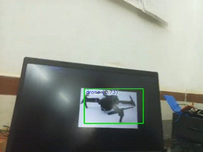
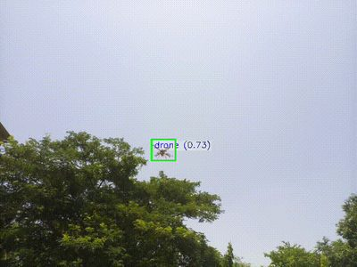
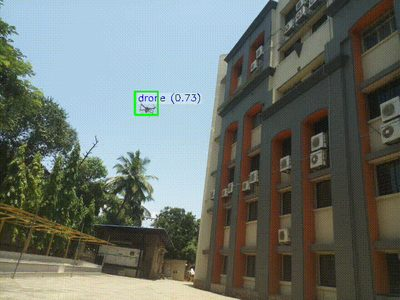
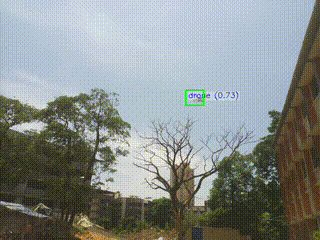
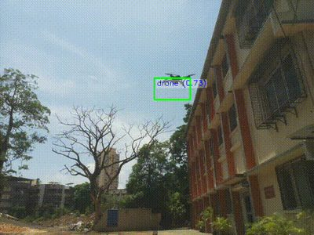
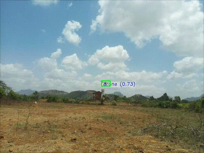
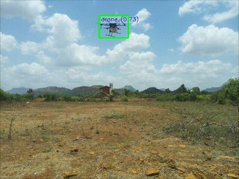
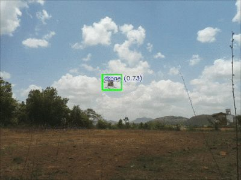
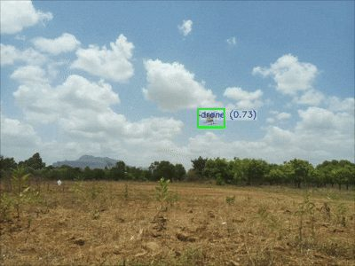
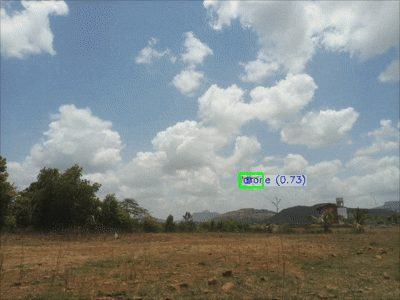

# Test Recordings

Footage of the Project Seraphim Sky drone detector running on its target hardware: a Raspberry Pi 5 with the Sony IMX500 AI Camera, where the model runs on the camera sensor itself. The boxes and labels were drawn live on the Pi.

Testing went in three rounds, from a desk to an open field:

1. **[Indoor bench test](#1-indoor-bench-test)**: a drone photo on a laptop screen · 1 recording · [`in-door/`](in-door)
2. **[Outdoor trials](#2-outdoor-trials)**: a campus courtyard, between trees and buildings · 4 recordings · [`out-door/trials-1/`](out-door/trials-1)
3. **[Outdoor final attempts](#3-outdoor-final-attempts)**: an open field under a cloudy sky · 5 recordings · [`out-door/final-attempts/`](out-door/final-attempts)

Every recording is here as a GIF and on YouTube as a video. The GIFs are 28–86 MB each (about 500 MB together), so the videos load much faster. Click a preview to play its video.

For the model, training and deployment behind these clips, see the [main README](../README.md).

---

## Reading the overlay

- **Green box**: something the model detected as a drone.
- **Label**: the class name and its confidence score, e.g. `drone (0.73)`.
- **Score**: 0.73 on almost every box. It plateaus there because of INT8 quantization on the sensor, as explained in the main README's [Technical Notes](../README.md#technical-notes). Other values are rare: during a close pass in final iteration 2 it flips between 0.73 and 0.88.

---

## 1. Indoor bench test

A desk check before any flights: the camera points at a drone photo on a laptop screen.

  

- **Bench test** (0:36): The photo stays boxed for almost the whole clip as the camera moves around it. [Video](https://youtu.be/j-8RWpgCHyM) · [GIF](in-door/indoor_testing.gif) (28 MB)

---

## 2. Outdoor trials

The first flights, on a campus courtyard with trees, buildings and bright sky.

  
  
  
  
   Takes 1–4, left to right and top to bottom.

- **Take 1** (1:43): Boxed on the ground at the start and end and for much of the flight, but lost for stretches against bright sky. [Video](https://youtu.be/478HzCcQR3A) · [GIF](out-door/trials-1/take1.gif) (86 MB)
- **Take 2** (1:21): The drone flies small against blue sky beside a tall building and is boxed only in short bursts. [Video](https://youtu.be/O8dWyrXIT6c) · [GIF](out-door/trials-1/take2.gif) (64 MB)
- **Take 3** (1:51): Boxed now and then in the sky. The bare tree is sometimes boxed as a drone too (a false alarm). [Video](https://youtu.be/XoHap88_YrY) · [GIF](out-door/trials-1/take3.gif) (29 MB)
- **Take 4** (1:31): Boxed on the ground at the start and in short bursts in the air, but mostly missed against bright sky. [Video](https://youtu.be/ha9-GHH9w2I) · [GIF](out-door/trials-1/take4.gif) (55 MB)

**What the trials showed:** detections come and go. Misses happen mostly when the drone is against bright, plain sky, which is the weakness described as the Sky-Background Gap in the main README's [Technical Notes](../README.md#technical-notes).

---

## 3. Outdoor final attempts

The last round: five recordings in an open field under a cloudy sky. While the drone is in view, it stays boxed almost continuously, even far away near the horizon.

  
  
  
  
  
   Iterations 1–5, left to right and top to bottom.

- **Iteration 1** (1:48): Boxed for almost the whole clip, even as a small speck just above the horizon. [Video](https://youtu.be/t2ZcmzPuLWs) · [GIF](out-door/final-attempts/final_iteration_1.gif) (45 MB)
- **Iteration 2** (1:35): The demo at the top of the main README. Includes a close pass (about 1:10 in the GIF) where the score flips between 0.73 and 0.88. [Video](https://youtu.be/Hb2t5CzQXDM) · [GIF](out-door/final-attempts/final_iteration_2.gif) (43 MB)
- **Iteration 3** (0:58): The shortest of the five: boxed from the first seconds almost to the end. [Video](https://youtu.be/-Y4pE9_w-u8) · [GIF](out-door/final-attempts/final_iteration_3.gif) (34 MB)
- **Iteration 4** (1:24): No drone in view for the first 29 seconds; after that it is boxed almost continuously. [Video](https://youtu.be/1RETE5MvYhY) · [GIF](out-door/final-attempts/final_iteration_4.gif) (54 MB)
- **Iteration 5** (1:37): Boxed for most of the clip. The drone leaves the frame for about ten seconds (1:08–1:19 in the GIF). [Video](https://youtu.be/0m6LsMKaPNc) · [GIF](out-door/final-attempts/final_iteration_5.gif) (57 MB)

---

Previews are single frames from each GIF, stored in [`previews/`](previews). To clone the repository without the GIFs, use the sparse checkout in the main README's [Quick Start](../README.md#2-get-the-code).
